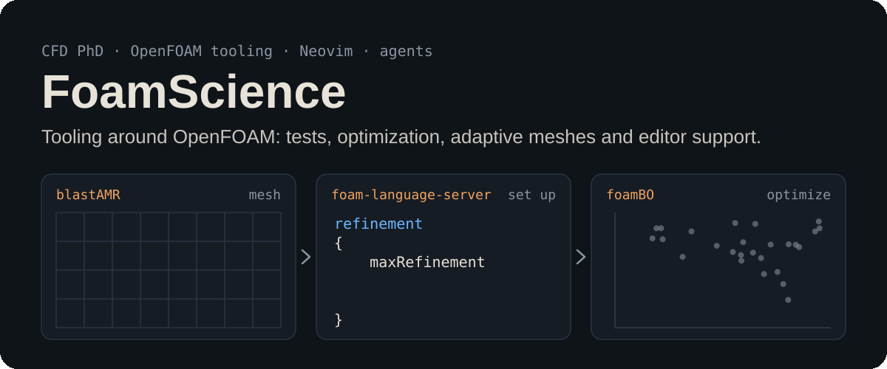

  

<!-- Owner: FoamScience. Last reviewed: 2026-11-08.
Review when: a new repo is released, a talk is given, a pinned repo is archived, the PhD ends. -->

Hi there 👋 I'm a CFD PhD student building the tooling around OpenFOAM: unit testing (foamUT),
multi-objective Bayesian optimization (foamBO), load-balanced AMR (blastAMR) and
editor support (language server, tree-sitter grammar). Outside OpenFOAM, I write
Neovim plugins and tools for working with AI coding agents. Just another Math guy
underneath.

You'll find cool OpenFOAM-related projects here, and a few that aren't.

**Latest (2026-11):** [OpenFOAM WASM](https://github.com/FoamScience/openfoam-wasm),
[ordo](https://github.com/FoamScience/ordo) and a batch of [Neovim plugins](#neovim-and-editor-tooling).

Where to start depends on what you need:

- Testing OpenFOAM code: [foamUT](https://github.com/FoamScience/foamUT)
- Optimizing OpenFOAM cases: [foamBO](https://github.com/FoamScience/OpenFOAM-Multi-Objective-Optimization)
- Adaptive mesh refinement: [blastAMR](https://github.com/STFS-TUDa/blastAMR)
- Editing OpenFOAM files: [foam-language-server](https://github.com/FoamScience/foam-language-server)
- Neovim and AI-agent tools: see [Neovim plugins](#neovim-and-editor-tooling) and [AI/agent tooling](#aiagent-tooling)

Questions or bugs: open an issue on the relevant repository.

<!--
**FoamScience/FoamScience** is a ✨ _special_ ✨ repository because its `README.md` (this file) appears on your GitHub profile.

Here are some ideas to get you started:

- 🔭 I’m currently working on ...
- 🌱 I’m currently learning ...
- 👯 I’m looking to collaborate on ...
- 🤔 I’m looking for help with ...
- 💬 Ask me about ...
- 📫 How to reach me: ...
- 😄 Pronouns: ...
- ⚡ Fun fact: ...
-->

## Projects

These are the repositories that **I deem** to be important and stable enough for mentioning here:

### OpenFOAM libraries and frameworks

- 🔭 [blastAMR](https://github.com/STFS-TUDa/blastAMR): Load-balanced Adaptive mesh refinement for polyhedral meshes in OpenFOAM
- 🧪 [foamUT](https://github.com/FoamScience/foamUT): Unit testing framework for OpenFOAM
- 🪡 [foamBO](https://github.com/FoamScience/OpenFOAM-Multi-Objective-Optimization): Near-Zero-Configuration
  Multi-objective optimization framework for OpenFOAM

- 🤔 [OpenFOAM-SmartSim](https://github.com/OFDataCommittee/openfoam-smartsim): OpenFOAM with ML through SmartSim - This has now made into openfoam.com releases as [a community submodule](https://gitlab.com/openfoam/community/sig-data-modelling/data-community)
- 👯 [OpenFOAM ML Hackathon](https://github.com/OFDataCommittee/OFMLHackathon):
  Yearly hackathon organized by the OpenFOAM Data-driven modelling SIG.

### OpenFOAM tools

- 🏸 [TreeSitter grammar for OpenFOAM](https://github.com/FoamScience/tree-sitter-foam): A tree-sitter grammar for OpenFOAM files
- 💬 [A language server for OpenFOAM files](https://github.com/FoamScience/foam-language-server): A language server for OpenFOAM dictionaries

- 📦 [OpenFOAM Apptainer containers](https://github.com/FoamScience/openfoam-apptainer-packaging):
  Automatically produce HPC-ready Apptainer containers for your OpenFOAM-based libraries
- 💨 [OpenFOAM code transformations](https://github.com/FoamScience/openfoam-code-transformations):
  Transform OpenFOAM code without the help of compilers; great for refactoring and formatting.
- 🌐 [OpenFOAM WASM](https://github.com/FoamScience/openfoam-wasm): Run OpenFOAM meshing and solving
  entirely in the browser via WebAssembly ([live demo](https://foamscience.github.io/openfoam-wasm/))

### OpenFOAM experiments

- ⚡ [OpenMP target offloading](https://github.com/FoamScience/OpenMP-OpenFOAM-benchmarks):
  Benchmarks for OpenFOAM with OpenMP target offloading.
- 🌱 [Views vs. Template Expressions](https://github.com/FoamScience/LazyEvaluation-OpenFOAM-Exp):
  Lazy evaluation with views and template expressions in OpenFOAM.
- 🌱 [Reflections](https://github.com/FoamScience/openfoam-reflections): Reflections in OpenFOAM

### Neovim and editor tooling

- 🤖 [agentfill-lsp.nvim](https://github.com/FoamScience/agentfill-lsp.nvim): An in-process language server
  for agent-based autocompletion
- 🔎 [m2v.nvim](https://github.com/FoamScience/m2v.nvim): Semantic, by-meaning code search on static
  embeddings from model2vec
- 🎫 [conflira.nvim](https://github.com/FoamScience/conflira.nvim): Work Jira issues and Confluence pages
  without leaving Neovim
- 🌿 [butlr.nvim](https://github.com/FoamScience/butlr.nvim): See which GitButler branch each hunk belongs to,
  and reassign, commit or unapply branches from the editor
- ⚡ [xonsh-language-server](https://github.com/FoamScience/xonsh-language-server) and
  [tree-sitter-xonsh](https://github.com/FoamScience/tree-sitter-xonsh): An LSP and a tree-sitter grammar for xonsh

### AI/agent tooling

- 🧭 [ordo](https://github.com/FoamScience/ordo): Reorder the hunks of a code change into a
  comprehension-optimized reading order
- 🎓 [wise-scholar](https://github.com/FoamScience/wise-scholar): A self-hosted AI tutor with a web interface
- 🚦 [claudetell](https://github.com/FoamScience/claudetell): Traffic-light overlay for running Claude Code sessions
- 📋 [beads-tui](https://github.com/FoamScience/beads-tui): A keyboard-first terminal UI for a beads task DB

## Talks and presentations

### Optimization

- 🎮 [MMA seminar](https://foamscience.github.io/mma-seminar-byes-opt-presentation/): Pave the way to
  optimize game balance using Bayesian Algorithms!
- 🔥 [SandiaD Flame](https://foamscience.github.io/SandiaD-LTS-Bayesian-Optimization): An introduction
  to Bayesian Optimization on CFD cases: `foamBO`
- 🔥 [Bayesian Optimization for combustion](https://foamscience.github.io/bayesian-optimization-for-combustion/):
  Optimization experiment and slides for combustion problems
- 🌀 [Annular thermal mixer](https://github.com/FoamScience/mixer-bayesian-optimization): Multi-objective
  Bayesian Optimization of an OpenFOAM case with `foamBO`

### Tooling

- 🧪 [Unit testing OpenFOAM code: foamUT](https://foamscience.github.io/openfoam-unit-testing-presentation)
- 📦 [Packaging HPC software: Apptainer](https://foamscience.github.io/openfoam-apptainer-containers-presentation/)

## Elsewhere

- 🚀 [Main personal blog](https://foamscience.github.io/) (not posting frequently, oops!)
- 📚 [OpenFOAM Parallelization course](https://openfoam-parallelisation-course.github.io/)
  (Best hands-on training ever made, with activities and mini projects)
- ✏️  [My Neovim Configs](https://github.com/FoamScience/configs.nvim)
  (Best NeoVim config for OpenFOAM development)
- 🎩 [Incomplete - PhD project docs](https://foamscience.github.io/MeshFreeFoam-Docs/)

## Stats

